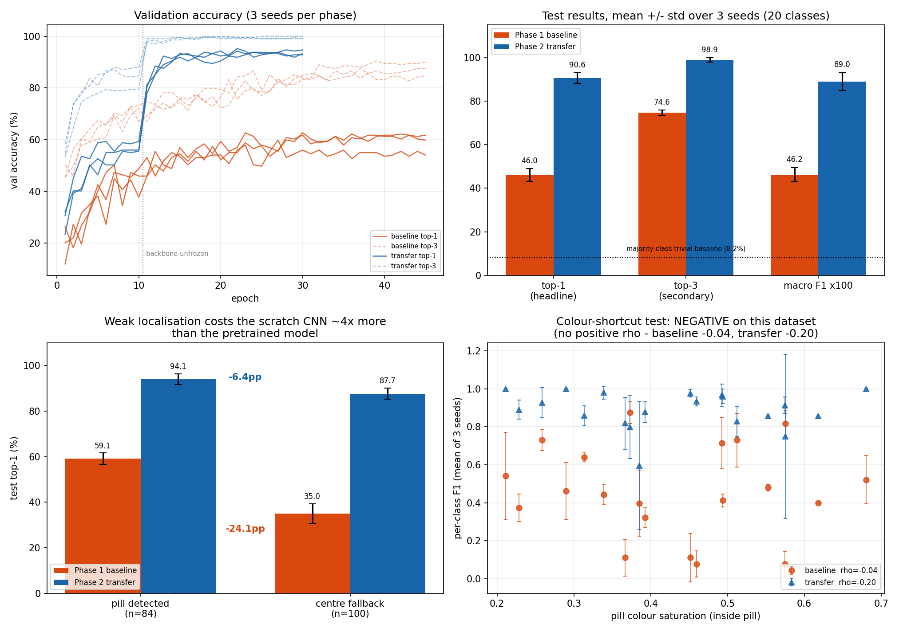

# Pill Image Identification

Multi-class image classifier that identifies a pharmaceutical tablet/capsule from a
consumer photograph. Built to [`pill-image-identification-baseline.md`](pill-image-identification-baseline.md).

**Headline:** on 20 products from the NIH C3PI consumer-photo set, ImageNet transfer
learning reaches **90.6 ± 2.5% top-1** against **46.0 ± 3.0%** for an equivalent CNN
trained from scratch — a **+44.6pp** gap, 11.5× the seed noise. Both clear the
majority-class trivial baseline (8.2%) by a wide margin.

The more interesting results are the negative ones: **neither model reads the pill
imprint**, and the colour-shortcut that dominated an earlier dataset **does not
appear here**. What limits the scratch CNN is not colour reliance but sensitivity to
crop quality.



*Working log, deviations from spec, and the bugs/retractions along the way:
[STATUS.md](STATUS.md).*

---

## 1. Dataset

**NIH C3PI Training image set** — the ~133,000 consumer-grade photographs, which
is the only C3PI release with enough real photos per pill for flat classification.
Served from `https://data.lhncbc.nlm.nih.gov/public/Pills/`.

The archive is unmaintained: C3PI was sunset in 2018, Pillbox retired January
2021, and the RxImage API is **dead** (connection fails). The file tree is still
up, though directory listing returns 403 while individual files return 200. The
bar-delimited index is public, so `src/fetch_c3pi.py` resolves exactly the images
we want rather than pulling the 2.6 TB whole.

### Which classes, and why

**20 classes, 1,212 real images, 47–101 per class (mean 60.6).** Full registry in
[`src/classes.py`](src/classes.py).

Two deliberate choices:

**Class unit is NDC-9, not NDC-11.** An 11-digit NDC ends in a 2-digit *package
size*, which does not change what the tablet looks like — so NDC-11 splits one
physical pill across several classes for no reason. NDC-9 (labeler + product) is
the unit that corresponds to one pill appearance.

**Multi-phase products excluded.** A triphasic contraceptive blister carries a
single NDC but contains differently-coloured tablets. Such a class is internally
inconsistent and would corrupt the section 8 imprint analysis. This removed
TRIVORA, BEYAZ, NORTEL 7/7/7, TRI-LEGEST Fe, MIRCETTE and BALZIVA — which,
awkwardly, are 6 of the best-populated products in the whole archive.

The subset contains five genuine **look-alike groups**, which is the point — §7
expects confusion between same-colour/same-shape pills and calls that the
interesting result:

| Group | Classes |
|---|---|
| `gabitril` | GABITRIL **2 / 4 / 16 mg** — one brand, three strengths |
| `levoxyl` | LEVOXYL 0.025 / 0.075 mg — dose pair |
| `glimepiride` | AMARYL 4 mg vs generic GLIMEPIRIDE — same drug, brand vs generic |
| `glyburide_metformin` | two GLYBURIDE+METFORMIN products |
| `capsule` | AMRIX, DEPAKOTE Sprinkle, FLUTAMIDE, NITROFURANTOIN — all capsules |

The remaining 7 classes have no look-alike partner, so a confusion between two of
them counts as cross-group (`evaluate.same_group` guards against treating two
partnerless classes as a shared group).

### The ≥100 images/class target is not achievable — measured, not assumed

Section 2 asks for **≥100 real images per class** and says to drop classes that
cannot clear it rather than augmenting them. **No C3PI subset can satisfy that at
15–30 classes.** Counted over the full 133,774-row index (still images only):

| Grouping | Products | **≥100 real images** |
|---|---|---|
| NDC-11 | 4,864 | 8 |
| **NDC-9** (correct visual unit) | 2,362 | **1** |
| Drug name | 2,837 | 188 |

*(Counts are of **unique image paths**. The index lists some photographs on several
rows — occasionally under two NDC-11 package variants, sometimes twice under the same
NDC-11. Counting rows inflated nine products by exactly 2×, and my first selection
included all nine before I caught it. Deduplicating dropped the "NDC-9 ≥100" figure
from 10 products to 1.)*

Only drug-name grouping clears the bar — and it does so by merging visually
different pills: 858 of 2,837 name-classes contain more than one distinct
product, and the largest are the worst (`LEVOTHYROXINE SODIUM` spans **23**
products, `ARIPIPRAZOLE TABLETS` 23, `LISINOPRIL` 13). That would make the label
a drug *family* rather than a pill, and would render the imprint analysis
meaningless.

Only **one** NDC-9 product reaches 100 unique consumer photos, and only 9 reach 60.
Requiring ≥100 real images *and* one consistent pill appearance per class leaves far
fewer than the 15-class floor.

So this project takes the documented trade: **keep 20 classes at 47–101 real images
and report the real counts**, never augmented ones. Augmentation regularises; it does
not add information.

### Framing: this is not how the literature treats the problem

Most published work on C3PI treats pill ID as **retrieval/matching** (reference
photo ↔ consumer photo) rather than flat classification, precisely because most
releases are few-shot per pill. Flat classification over a curated 20-class subset
is a valid learning exercise, but it is deliberately **not** the standard framing —
noted here so the scoping is a choice rather than an oversight. Reframing as
retrieval is listed under stretch goals.

### Rejected alternatives (checked, not assumed)

| Source | Verdict | Measured reason |
|---|---|---|
| **ePillID** (CVPR 2020) | rejected | Downloads fine (160 MB), but `all_labels.csv` gives 13,532 images over **4,902 classes — max 7 per class**, counting both faces *and* studio references. Consumer photos peak at 5/class. A deliberately low-shot benchmark. |
| **OGYEIv2** (Kaggle, 112 classes) | rejected | Exactly 40 images/class, controlled capture, shipped polygons and paired lighting. Better instrumented than C3PI but **not the mandated release**, and further from the ≥100 target. Prior results archived under `outputs/_ogyeiv2_archive/`. |

---

## 2. Localisation: the step that makes the imprint legible

In C3PI photos the pill spans roughly **10–15% of frame width**, sits off-centre,
and lies on a real countertop or fabric under uncontrolled lighting. Resizing the
whole frame to 224×224 leaves the pill ~39 px across, which erases the imprint —
the exact feature section 8 exists to test for.

[`src/localize.py`](src/localize.py) flattens illumination, scores three
complementary cues (colour residual, saturation, gradient energy), Otsu-thresholds,
then picks the best connected component by geometry.

**This took three iterations, and the failures are instructive:**

1. A naive "deviation from median colour" detector locked onto the **illumination
   gradient** and returned boxes covering 89–98% of the frame. Fixed by dividing
   out a heavy blur *before* thresholding.
2. v2 reached ~67% on visual audit; the failures picked sub-0.5%-area background
   specks, so the crop was bare countertop. Fixed with an area floor.
3. v2 also locked onto a **US quarter** — some C3PI photos include a coin as a
   size reference, and a coin is rounder and higher-contrast than many tablets.
   Fixed by weighting centrality hard and penalising edge-touching blobs.

Where nothing plausible survives, it falls back to a centre crop and **records
that in the manifest**. A silent fallback is indistinguishable from a successful
detection and would quietly become label noise; `evaluate.py` therefore reports
accuracy separately for detected vs fallback crops.

**Audited result (24 random crops, inspected by eye):**

| | |
|---|---|
| crops containing the pill | **24 / 24** |
| detection vs centre fallback (full run) | **56.6% / 43.4%** |
| median pill width at 224 input | **139.9 px** (vs 34.7 px naive) — **4.0×** |

---

## 3. Method

**Split** — 70/15/15 stratified by class, fixed seed, **grouped by capture session**.
C3PI ships no split of its own. Final composition: **819 / 209 / 184 = 67.6 / 17.2 / 15.2%** — see below for
why it drifts off 70/15/15.

#### The near-duplicate leakage that invalidated a first set of results

A plain per-image split produced **97.3% val top-1**, which was too good for real
countertop photos. It was. C3PI photographs were captured in batches — the same
physical tablet shot repeatedly in one session, same surface, same light — so an
image-level split puts near-identical twins on both sides.

Byte-identical duplicate checks found **nothing**. Perceptual comparison
([`src/check_leakage.py`](src/check_leakage.py), 32×32 contrast-normalised signature,
cosine distance, rotation-aware) found this:

| test images within… of a same-class train image | image split | **grouped split** |
|---|---|---|
| 0.02 (near-identical) | **21.1%** | **0.0%** |
| 0.05 (very similar) | 37.8% | 0.0% |
| 0.10 (similar) | 52.2% | 8.7% |

Different-class distances bottom out around 0.096, so those sub-0.02 pairs were
effectively the same photograph — closest pair measured **0.0008**. Inspection
confirmed it: identical pill, identical pose, identical background.

**Fix:** cluster images by appearance within each class and assign whole clusters to
one split, so twins cannot straddle the boundary. Threshold 0.08, below the
different-class floor, which yields **675 capture groups** from 1,212 images — **708
images (58%) belong to a multi-image group**, largest group 51 shots of one pill.
Groups are indivisible, so image-level proportions can only be approximated; the
quota-greedy allocation lands at 67.6/17.2/15.2. That drift is the honest price of
not splitting duplicates.

Both held-out splits were then re-verified (train↔test **and** train↔valid): 0% of
either within 0.05 of a training image, minimum distance 0.084 — above the grouping
threshold, as it must be by construction.

Everything reported in §5 uses the grouped split. The 97.3% figure is retracted.

**Augmentation — deliberately conservative (§5).** Section 8 tests whether the
model reads the imprint, so augmentation that destroys imprint legibility would
train the model to ignore the very feature we then measure:

| Transform | Setting | Why |
|---|---|---|
| Rotation | **full 0–360°** | pills are shot at arbitrary angles; imprints stay legible |
| Flips | **none** | a mirrored imprint exists on no real pill. Flipping teaches the model that reversed text is valid — actively harmful here, though standard elsewhere |
| Blur | σ 0.1–0.6, p=0.2 | phone photos are soft; heavy blur erases imprint text |
| Brightness/contrast | ±0.2 | lighting varies |

**Phase 1** — 4 × (Conv2d → BatchNorm → ReLU → MaxPool), 32→64→128→256, global
average pool, dense head. 462k params, from scratch. AdamW lr 1e-3, batch 32,
cosine schedule.

**Phase 2** — ResNet18 / EfficientNet-B0, ImageNet weights. Stage 1 freezes the
backbone and trains the head at lr 1e-3 (BatchNorm statistics frozen too,
otherwise "frozen" features still drift on small batches); stage 2 unfreezes the
last 2 blocks at lr 1e-4. Per §6 this is a *hypothesis*, not a foregone
conclusion — "the baseline held up" would be reported as a legitimate finding.

**Metrics (§7)** — **top-1 is the headline**, with macro-F1 and per-class
precision/recall/F1. **Top-3** is reported only as a secondary "close enough for a
lookup tool" signal and is labelled as such. **Top-5 is deliberately not
reported**: at 20 classes it is 25% by chance and conveys almost nothing.

**Seeds** — every headline number is mean ± std over 3 seeds (42/1/2); at this
data scale a 2-point gap is seed noise.

**Trivial baselines** — majority-class and stratified-random are computed before
any model, so a headline accuracy cannot be mistaken for a class-imbalance
artefact.

---

## 4. Interpretability (§8)

[`src/gradcam.py`](src/gradcam.py) asks whether the model reads the imprint or
shortcuts on colour and shape, sampling **both correct and incorrect** predictions
per class. Three measures against an estimated pill mask:

- **`on_pill`** — CAM mass inside the pill silhouette. Low ⇒ using background.
- **`interior`** — share of on-pill mass in the eroded interior vs the rim.
  Imprints live in the interior; a silhouette detector fires on the rim.
- **`imprint_corr`** — Spearman correlation between CAM and local edge energy,
  computed **inside the eroded interior only**.

> The interior restriction matters and was a bug I had to fix: the pill's own
> outline is the strongest edge present, so correlating across the whole pill
> measures "is the CAM near the outline" and reads negative for *any*
> interior-focused model. Validated on synthetic images with a known imprint,
> the corrected metric ranks imprint-reader **+0.259** > flat-interior **+0.097**
> > rim-reader **−0.099**.

Alongside it, `make_figures.py` correlates per-class F1 against in-pill colour
saturation — a direct test for the colour shortcut.

**Two honest limitations of doing this on C3PI:**
1. C3PI ships **no segmentation ground truth**, so the mask is *estimated* from
   the image. The numbers are good-faith estimates, not exact measurements.
2. C3PI has **no paired lighting conditions**, so the "engravings visible vs
   washed out" controlled A/B test is unavailable. That comparison was the
   strongest single piece of evidence available on a controlled-capture set, and
   moving to C3PI gives it up. The colour-saturation analysis carries that load.

### Findings — both negative, and both worth having

Mean ± std over 3 seeds:

| measure | baseline | transfer |
|---|---|---|
| `on_pill` | 0.535 ± 0.007 | 0.409 ± 0.004 |
| `interior` | 0.552 ± 0.017 | 0.527 ± 0.001 |
| **`imprint_corr`** | **−0.056 ± 0.011** | **+0.003 ± 0.003** |
| ρ(colour saturation, per-class F1) | −0.04 | −0.20 |
| mean F1, colourful half / pale half | 0.434 / 0.490 | 0.905 / 0.875 |

**1. Neither model reads the imprint.** The scratch CNN's attention is mildly
*anti*-correlated with engraved detail (−0.056); the transfer model's is
indistinguishable from zero (+0.003). So the 90.6% is *not* achieved by reading
imprints.

**2. There is no colour shortcut here.** ρ(saturation, F1) is negative for both
models, and transfer's accuracy on pale pills (0.875) matches its accuracy on
colourful ones (0.905). On an earlier dataset (OGYEIv2) I measured ρ = **+0.77** for
the scratch CNN with F1 of 0.22 on white pills versus 0.89 on coloured — a textbook
colour shortcut. **That finding did not replicate on C3PI.** It was dataset-specific,
and reporting it as a general property of scratch CNNs would have been wrong.

**What the model appears to use instead:** gross appearance — outline, size, aspect
ratio, broad colour and surface texture. That is sufficient for 20 mostly-distinct
products, and it predicts the failure mode we observe: errors concentrate in the
look-alike groups (8% → 25% of errors as accuracy rises), which is precisely where
gross appearance is uninformative and the imprint is the only discriminator.

**Why the imprint is probably unavailable rather than ignored.** Median pill width is
140 px in the crop, and 43% of crops are centre-fallbacks where the pill is smaller
still. At that scale engraved text on a consumer phone photo is often not resolvable
at all. This is a *plausible* explanation, not a demonstrated one — separating
"cannot see the imprint" from "can see it but does not use it" would need
higher-resolution crops or the paired-lighting capture C3PI lacks.

**One number I do not trust.** Transfer's `on_pill` is 0.409 — *lower* than the
baseline's 0.535 — while being twice as accurate. Either the model genuinely uses
context outside the pill outline, or my estimated mask under-covers the pill on
textured countertops. With no ground-truth masks in C3PI I cannot separate those,
so I am not drawing a conclusion from `on_pill` on this dataset.

---

## 5. Results

Test set: **184 held-out images, 20 classes**, mean ± std over 3 seeds (42/1/2).

| Model | Top-1 (headline) | Top-3 (secondary) | Macro F1 |
|---|---|---|---|
| Stratified-random | 5.40 ± 1.67% | 15.08 ± 2.69% | — |
| Majority-class | 8.15% | 22.83% | — |
| Phase 1 — CNN from scratch (460k params) | 46.01 ± 2.99% | 74.64 ± 1.26% | 0.462 ± 0.033 |
| **Phase 2 — ResNet18, ImageNet (11.2M)** | **90.58 ± 2.45%** | **98.91 ± 0.94%** | **0.890 ± 0.041** |

**+44.56pp top-1, which is 11.5× the combined seed std (3.87pp)** — real, not noise.
§6 framed transfer learning as a hypothesis and allowed "the baseline held up" as a
legitimate finding; it did not hold up.

Top-3 is reported only as the "close enough for a lookup tool" signal §7 permits.
**Top-5 is not reported**: at 20 classes it is 25% by chance.

### Localisation quality, not colour, is what limits the scratch CNN

Accuracy split by how each crop was obtained (§ 2 records this per image):

| | pill detected (n=84) | centre fallback (n=100) | cost of weak localisation |
|---|---|---|---|
| Phase 1 baseline | 59.1 ± 2.5% | 35.0 ± 4.4% | **−24.1pp** |
| Phase 2 transfer | 94.1 ± 2.4% | 87.7 ± 2.5% | −6.4pp |

The scratch CNN loses roughly a quarter of its accuracy when the pill is only
roughly framed; the pretrained model loses a quarter of that. Two consequences
worth stating plainly:

* Part of the baseline's apparent weakness is **my localiser**, not the model.
* The grouped split happened to place 54% fallback crops in test versus 42% in
  valid, which is why baseline val (61.4%) sits ~15pp above baseline test (46.0%).
  **Test is genuinely the harder split here** — that gap is composition, not
  overfitting.

### Per-class F1 (mean of 3 seeds)

| class | look-alike group | baseline | transfer | Δ |
|---|---|---|---|---|
| `amaryl_4mg` | glimepiride | 0.11 | 0.98 | +0.87 |
| `bethanechol_10mg` | — | 0.08 | 0.93 | +0.86 |
| `amrix_30mg_cap` | capsule | 0.08 | 0.91 | +0.84 |
| `levoxyl_0_025mg` | levoxyl | 0.11 | 0.82 | +0.71 |
| `gabitril_2mg` | gabitril | 0.32 | 0.88 | +0.55 |
| `allopurinol_300mg` | — | 0.41 | 0.96 | +0.55 |
| `fluconazole_100mg` | — | 0.46 | 1.00 | +0.54 |
| `glimepiride_generic` | glimepiride | 0.44 | 0.98 | +0.54 |
| `levoxyl_0_075mg` | levoxyl | 0.37 | 0.89 | +0.52 |
| `depakote_sprinkle` | capsule | 0.52 | 1.00 | +0.48 |
| `nitrofurantoin_cap` | capsule | 0.54 | 1.00 | +0.46 |
| `hydralazine` | — | 0.40 | 0.86 | +0.46 |
| `fludrocortisone` | — | 0.48 | 0.86 | +0.38 |
| `flutamide_cap` | capsule | 0.72 | 0.97 | +0.25 |
| `gabitril_4mg` | gabitril | 0.64 | 0.86 | +0.22 |
| `glipizide_metformin` | — | 0.40 | 0.60 | +0.20 |
| `gabitril_16mg` | gabitril | 0.73 | 0.93 | +0.20 |
| `hyzaar_50_12_5` | — | 0.73 | 0.83 | +0.10 |
| `glyburide_metformin_a` | glyburide_metformin | 0.82 | **0.75** | **−0.07** |
| `glyburide_metformin_b` | glyburide_metformin | 0.88 | **0.80** | **−0.08** |

**Transfer learning is not uniformly better.** The only two classes it hurt are
both halves of the *same* look-alike pair. The baseline scored well on them by
collapsing the pair onto one label and getting lucky on support; the transfer model
tries to separate them and sometimes picks the wrong member. Worst remaining class
overall is `glipizide_metformin` (0.60), whose errors go almost entirely to
`glyburide_metformin_b` — a different drug in a visually similar tablet.

### Errors concentrate exactly where the imprint matters

| | errors (pooled, 3 seeds) | inside a look-alike group |
|---|---|---|
| Phase 1 baseline | 254 | 21 (**8%**) |
| Phase 2 transfer | 52 | 13 (**25%**) |

As accuracy rises, surviving errors move *into* the look-alike groups — the cases
where colour and shape coincide and only the imprint separates the classes. Top
confusions for transfer: `levoxyl_0_025 → levoxyl_0_075` (6×),
`gabitril_2mg → gabitril_4mg`, `glyburide_metformin_a → _b`.

Full per-class metrics for every run are in `outputs/metrics.csv`
(schema: `phase, seed, class, support, precision, recall, f1, accuracy_overall,
macro_f1, notes`); confusion figures and most-confused-pairs tables are per-run in
`outputs/`.

---

## 6. Reproducing

```bash
python -m venv .venv && .venv/Scripts/pip install -r requirements.txt
python src/classes.py                # verify the class registry
python src/fetch_c3pi.py --dry-run   # report counts before downloading
python src/fetch_c3pi.py             # 1,212 images; resumable
python src/preprocess.py             # localise + crop + stratified split
python src/trivial_baseline.py       # majority + stratified-random FIRST

for s in 42 1 2; do
  python src/train.py --phase baseline --epochs 45 --seed $s --tag baseline_s$s
  python src/train.py --phase transfer --epochs 30 --seed $s --tag transfer_s$s
done
for c in outputs/checkpoints/*_best.pt; do
  python src/evaluate.py --checkpoint "$c" --split test
  python src/gradcam.py  --checkpoint "$c" --split test --per-class 4
done
python src/aggregate_seeds.py         # mean +/- std tables
python src/make_figures.py
```

Host is CPU-only — `torch.cuda.is_available()` is False, so §3's "confirm a GPU
tensor op works" was verified as a **CPU** forward+backward pass instead, and
`requirements.txt` (generated by `pip freeze`) pins the CPU torch wheels. Remove the
`--extra-index-url` line on a CUDA machine.

Timing: one seed of both phases is ~2 h; all six runs took ~5 h wall-clock, with one
epoch stalling to 57 min under contention.

**Phase 2 uses ResNet18.** §6 permits ResNet18 *or* EfficientNet-B0; the
EfficientNet-B0 path is implemented and smoke-tested (`python src/model_transfer.py`)
but was not trained, so no EfficientNet numbers are reported.

### Layout

```
src/
├── classes.py           class registry: NDC-9 ids, labels, look-alike groups
├── fetch_c3pi.py        resolve + download the subset from the NLM index
├── localize.py          pill detector with audited centre-crop fallback
├── preprocess.py        crop to 224 + stratified 70/15/15 + manifest
├── dataset.py           loaders, conservative augmentation
├── model_baseline.py    Phase 1 CNN
├── model_transfer.py    Phase 2 backbones + staged freeze/unfreeze
├── train.py             training loop, top-1/top-3
├── trivial_baseline.py  majority-class + stratified-random
├── evaluate.py          top-1, per-class metrics, confusion + confused pairs
├── gradcam.py           attention measures + figure grid
├── aggregate_seeds.py   mean +/- std across seeds
└── make_figures.py      summary figure

outputs/
├── checkpoints/         *_best.pt (gitignored)
├── metrics.csv          section 0 schema: phase, seed, class, ..., notes
├── summary_seeds.csv    mean +/- std per phase
├── confused_pairs_*.csv most-confused-pairs tables
├── figures/
└── _ogyeiv2_archive/    superseded OGYEIv2 run - do not quote
```

## 7. What 90.6% does and does not mean

Read the headline with these in mind. None of them are hypothetical — each is
measured or structural.

**It covers 20 of ~2,362 products.** That is **0.8%** of the C3PI products that have
any consumer photo, and C3PI is itself a fraction of the ~100k NDCs on the US market.
The 20 were chosen partly *because* they were the best-photographed, so they are a
favourable sample, not a representative one.

**It is a closed set — the model cannot say "I don't know."** Softmax over 20 classes
always sums to 1, so a photograph of any of the other ~2,342 products returns one of
our 20 with high confidence. For a pill identifier that is the worst failure mode
available: a wrong drug name, delivered fluently. Any deployment needs a measured
rejection path, not a guessed confidence threshold.

**More classes would not fix it.** The images-per-class ceiling is hard:

| images/class floor | classes available |
|---|---|
| ≥47 (used here) | 29 |
| ≥40 | 76 |
| ≥30 | 268 |
| ≥10 | 2,349 |

You can have 2,349 classes at ~10 photos each, or 29 at 47+. This is why §2 notes the
literature treats pill ID as **retrieval/matching** rather than flat classification —
matching scales because adding a pill means adding a reference image, not retraining.

**It does not read the imprint** (§4), so it cannot be expected to separate two white
round tablets that differ only by their marking — the case a real tool most needs.

**~40% of the headline gap is attributable to my localiser**, in the sense that
fallback-cropped images score 24pp lower for the baseline. A better detector would
lift Phase 1 more than Phase 2.

## 8. Demo, and what rejection actually costs

[`demo/`](demo/) implements §10's stretch goal: upload a photo, get top-3 with
confidence, or an honest refusal. See [demo/README.md](demo/README.md).

Because the model is a closed set, the demo needs to decline. How well it can is
measured, not assumed — `src/ood_rejection.py` runs ~100 C3PI photographs of 20
products **outside** the 20 classes through the identical pipeline:

Out-of-set images have median confidence **0.637**; in-distribution *wrong* predictions
sit at **0.639**. Max-softmax cannot separate "never seen this pill" from "got this pill
wrong" — both are just confusion.

| threshold | coverage | precision | out-of-set still named |
|---|---|---|---|
| 0.560 (naive "keep 95% of correct") | 97% | 95.6% | **61%** |
| **0.828 (used)** | **76.6%** | **99.4%** | **24%** |
| 0.90 | 67.0% | 100% | 15% |

Threshold chosen on validation as the lowest reaching 99% precision: for a pill
identifier, naming the wrong drug is worse than declining. **~1 in 4 out-of-set pills
still gets named**, which the UI states plainly. The naive threshold would have let
through 61%.

The demo imports `localize.py` and `dataset.build_transforms` rather than
reimplementing preprocessing, returns the 224px crop it actually classified (43% are
centre-fallbacks, and a bad crop is otherwise invisible), and refuses to start if the
rejection measurement is missing rather than inventing a cutoff.

## 9. Next

1. **Better localisation** — the single highest-leverage change for Phase 1, and it
   would also let the imprint question be asked at a resolution where the answer
   means something.
4. **Reframe as retrieval/matching**, which is both how the literature does it and the
   only version of this that scales past a few hundred pills.
5. Multi-attribute heads (shape / colour / imprint) per §10, making the imprint
   question directly supervised rather than inferred.
